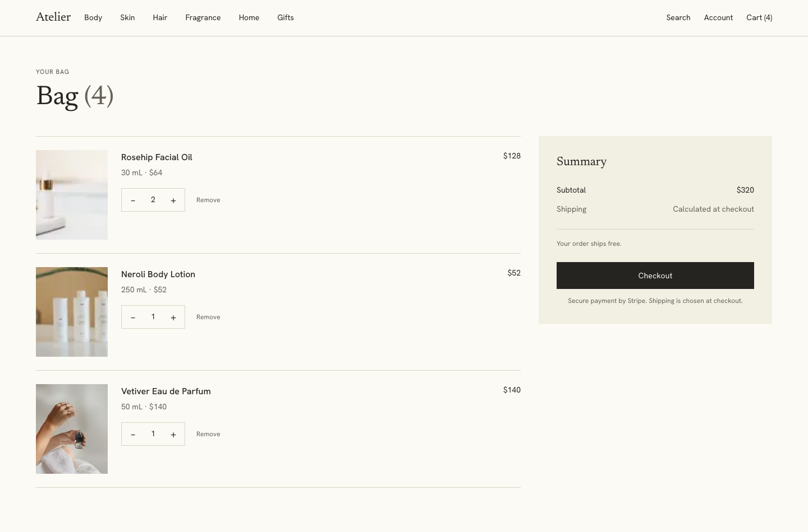
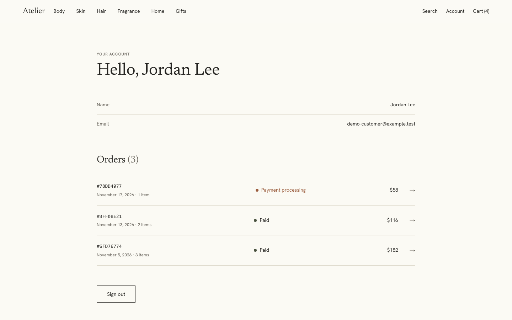
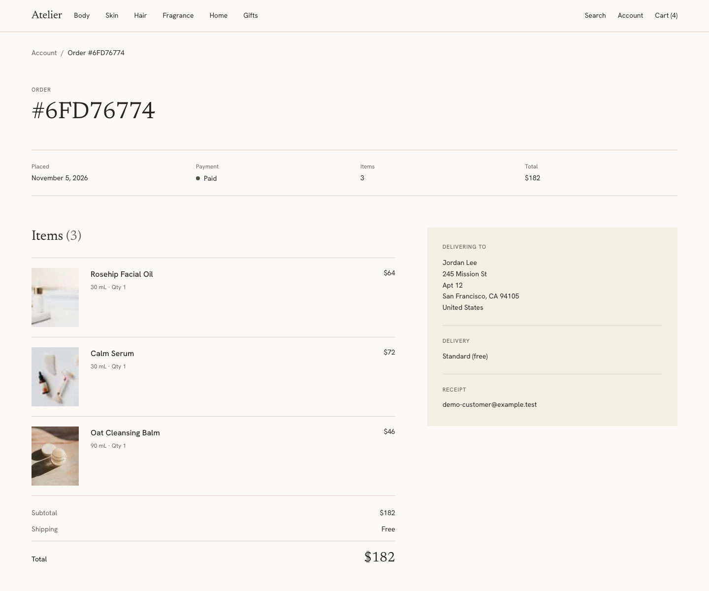
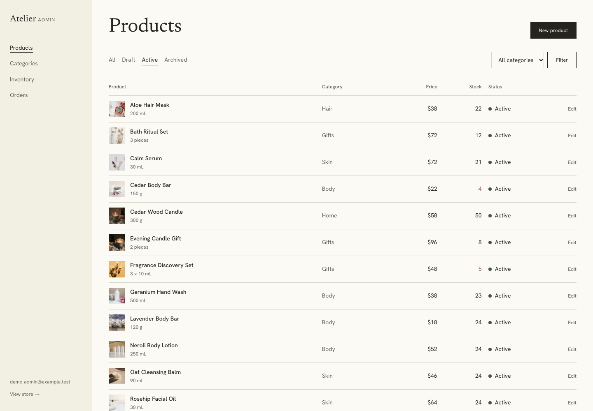
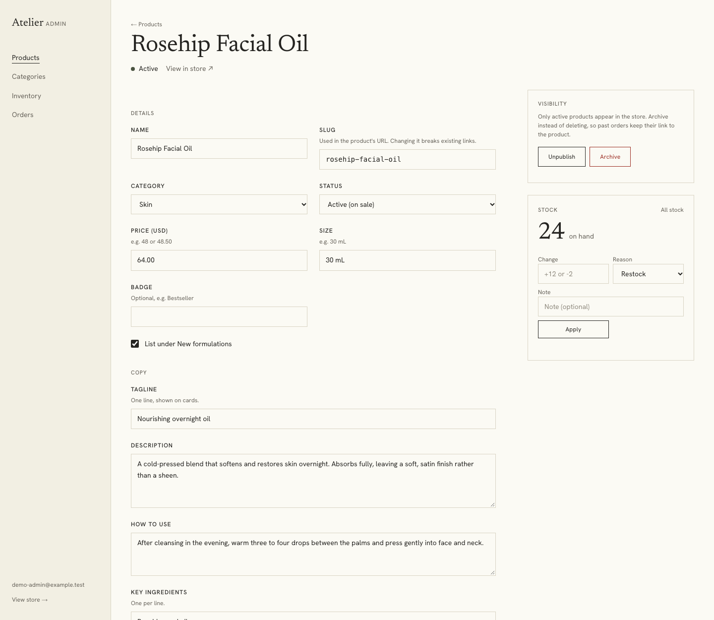
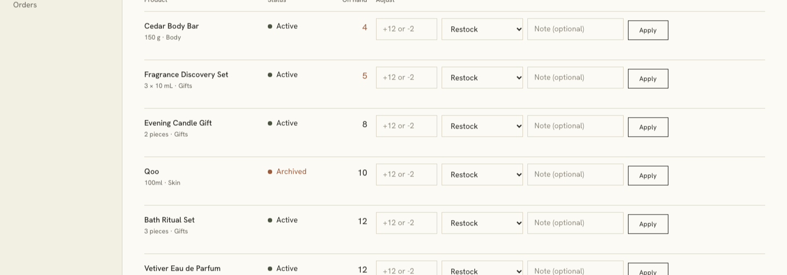
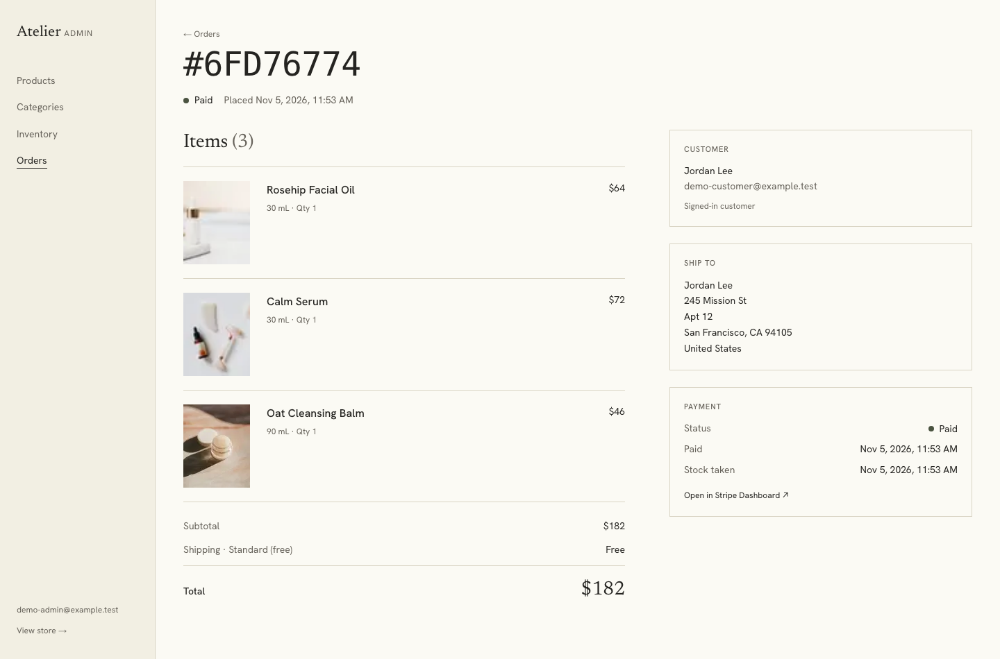

# Atelier

**A full-stack e-commerce store for an apothecary-style skincare brand: storefront, customer accounts, Stripe checkout, and an admin back office.**

Built with Next.js 16 (App Router, Cache Components), TypeScript, Better Auth, Drizzle ORM on Neon Postgres, Stripe Checkout and Tailwind CSS v4.

[繁體中文說明](README.zh-TW.md)


## Contents

- [Features](#features)
- [Tech stack](#tech-stack)
- [Engineering highlights](#engineering-highlights)
- [Screenshots](#screenshots)
- [Architecture](#architecture)
- [Getting started](#getting-started)
- [Scripts](#scripts)
- [Status and roadmap](#status-and-roadmap)

## Features

**Storefront**
- Editorial homepage, category pages, "New formulations" and product pages. Catalogue reads are cached and prerendered.
- Live stock status: "Only 3 left" and sold-out states. Sold-out or archived products can't be added to the bag.
- Responsive layout with a mobile navigation drawer and reduced-motion-aware micro-animations.

**Accounts**
- Email and password sign-up, plus optional Google sign-in that links to an existing account with the same verified email.
- Guest bags live in the database behind an httpOnly cookie and merge into the customer's bag on sign-in.
- Order history and order detail pages. Every query is scoped to the signed-in customer.

**Checkout and orders**
- Stripe Checkout with shipping address collection and standard or express rates (free standard shipping over $75). Prices always come from the database, never from the browser.
- A signed Stripe webhook records the order, takes stock and clears the bag. It is safe to retry and safe to receive out of order.
- The order confirmation page shows items, delivery details and next steps.

**Admin back office** (`/admin`, admins only)
- Products: list, filter, create and edit. Products are published, unpublished or archived rather than deleted.
- Categories: create, edit, reorder (the storefront navigation follows the order), and delete only when empty.
- Inventory: lowest stock first. Each relative adjustment (restock, count correction, damaged) is recorded in a ledger with who made it and why.
- Orders: a paginated list filtered by payment status, and an order detail page that links to the Stripe Dashboard.

## Tech stack

| Area | Choice |
| --- | --- |
| Framework | Next.js 16 App Router with Cache Components, React 19, TypeScript |
| Styling | Tailwind CSS v4 with a custom token-based design system (no UI kit) |
| Database | Neon serverless Postgres via Drizzle ORM (`neon-http`), SQL migrations |
| Auth | Better Auth: email/password, Google OAuth, a role field |
| Payments | Stripe Checkout (hosted), webhooks, Stripe CLI for local forwarding |
| Validation | Zod, both for environment variables at startup and for every Server Action input |

## Engineering highlights

These are the parts worth looking at in the code:

**1. Idempotent order fulfillment** — [`src/db/queries/orders.ts`](src/db/queries/orders.ts), [`src/app/api/webhooks/stripe/route.ts`](src/app/api/webhooks/stripe/route.ts)
Stripe may deliver an event more than once or out of order, so the webhook:
- Verifies the signature against the raw body.
- Re-fetches the Checkout Session instead of trusting the event payload.
- Creates the order under a unique `stripe_checkout_session_id`.

Stock is taken in a **single SQL statement**. It claims `orders.stock_deducted_at` and decrements inventory in the same statement, so a concurrent retry blocks on the row and then finds nothing left to do. Items are matched by product id, so renaming a product's slug mid-checkout can't skip the stock deduction.

**2. Stock changes that can't overwrite each other** — [`src/app/admin/inventory/actions.ts`](src/app/admin/inventory/actions.ts)
Admin adjustments are relative (`+12`, `-2`), not "set to N". One statement applies the change and writes the ledger row, but only if stock still equals what the admin saw. If an order was paid in the meantime, the admin gets a conflict message and nothing is applied, so the webhook's deduction is never overwritten. Stock can't go below zero. The serverless driver has no interactive transactions, so every multi-step write is either one statement or an atomic `db.batch`.

**3. Authorization in depth** — [`src/lib/dal.ts`](src/lib/dal.ts)
- The admin role is a `user.role` column declared to Better Auth with `input: false`, so sign-up and update-user requests can't set it.
- A server-only data access layer checks the role in three places: every admin page, every admin Server Action (before any input is parsed), and every admin query.
- Non-admins get a 404, so the admin area isn't advertised.
- This was verified by calling each Server Action directly with a customer session: every call was rejected and the database was unchanged.

**4. Next.js 16 Cache Components**
- Catalogue reads use `"use cache"` with `cacheTag("catalog")`, so pages prerender into a static shell.
- Per-visitor parts (the bag count, accounts, order pages) stream inside `<Suspense>`.
- Admin Server Actions call `updateTag("catalog")` and the webhook calls `revalidateTag`, so an edit or a sale reaches the store immediately.

**5. Data that stays correct over time**
- Order items snapshot the name, size and price at purchase.
- Products are archived rather than deleted. Archived products disappear from the store; any already in a bag are flagged and block checkout.
- Schema changes go through reviewed SQL migrations (`drizzle/`), never `db push`.

## Screenshots

| Storefront | |
| --- | --- |
|  |  |
| Product page | Bag with live totals and free-shipping threshold |
|  |  |
| Account and order history | Order detail |

| Admin | |
| --- | --- |
|  |  |
| Products with stock and status | Product editor with visibility and a stock panel |
|  |  |
| Inventory, lowest first, with inline adjustments | Order detail |

<p align="center"></p>

## Architecture

```
src/
  app/
    (store)/            Storefront route group: home, shop, products, cart, checkout, account, sign-in
    admin/              Back office: products, categories, inventory, orders (own layout)
    api/auth/           Better Auth handler
    api/webhooks/stripe Stripe webhook: verifies, then fulfills
  components/           UI primitives, storefront, cart, orders and admin components
  db/
    schema/             Drizzle tables: catalogue, auth, carts, orders, inventory ledger
    queries/            Data access: cached catalogue reads, carts, orders, admin queries
    seed/               Starting catalogue (pnpm db:seed)
  lib/
    env.ts              Zod-validated environment, read once at startup
    auth.ts, dal.ts     Better Auth config, and role checks for pages, actions and queries
    stripe.ts           Stripe client
drizzle/                Reviewed SQL migrations
```

**Data model:** `categories`, `products` (with `status`), `inventory` (1:1 with products), `inventory_adjustments` (ledger), `carts` and `cart_items`, `orders` and `order_items` (price snapshots), plus Better Auth's `user`, `session`, `account` and `verification`.

## Getting started

**Prerequisites:** Node.js 20+, pnpm, a [Neon](https://neon.tech) Postgres database, a [Stripe](https://stripe.com) sandbox account and the [Stripe CLI](https://docs.stripe.com/stripe-cli).

```bash
pnpm install
cp .env.example .env.local      # then fill in the values below
pnpm db:migrate                 # create the tables
pnpm db:seed                    # load the sample catalogue (resets stock)
pnpm dev
```

| Variable | Purpose |
| --- | --- |
| `DATABASE_URL` | Neon connection string |
| `BETTER_AUTH_SECRET` | Session signing secret (`openssl rand -base64 32`) |
| `BETTER_AUTH_URL`, `NEXT_PUBLIC_APP_URL` | App URL, e.g. `http://localhost:3000` |
| `STRIPE_SECRET_KEY` | Stripe test-mode key (`sk_test_…` or a restricted `rk_test_…`) |
| `STRIPE_WEBHOOK_SECRET` | `whsec_…` printed by `stripe listen` (below) |
| `GOOGLE_CLIENT_ID`, `GOOGLE_CLIENT_SECRET` | Optional; the Google button appears only when both are set |

**Receive Stripe webhooks locally** (in a second terminal):

```bash
stripe listen \
  --events checkout.session.completed,checkout.session.async_payment_succeeded,checkout.session.async_payment_failed \
  --forward-to localhost:3000/api/webhooks/stripe
```

Pay with the test card `4242 4242 4242 4242`, any future expiry date and any CVC.

**Make yourself an admin.** There is deliberately no self-service promotion. Sign up, then run:

```sql
UPDATE "user" SET role = 'admin' WHERE email = 'you@example.com';
```

## Scripts

| Command | Purpose |
| --- | --- |
| `pnpm dev` / `pnpm build` / `pnpm start` | Run, build and serve the app |
| `pnpm lint` / `pnpm typecheck` | ESLint, and `next typegen && tsc --noEmit` |
| `pnpm db:generate` / `pnpm db:migrate` | Write SQL migrations from the schema, then apply them |
| `pnpm db:seed` | Upsert the sample catalogue (resets stock and product edits) |
| `pnpm db:studio` | Browse the database |

## Status and roadmap

This is a portfolio project running against Stripe's sandbox. Payments are test mode only.

**Verification:** there is no automated test suite yet. Each change was checked with `pnpm typecheck`, `pnpm lint` and `pnpm build`, scripted HTTP and Server Action calls (including authorization checks for each role), database assertions, and desktop and mobile screenshots.

**Next steps**
- Order emails: confirmation, shipping and refunds.
- Fulfilment status and tracking numbers.
- Refunds through the Stripe API, reconciled by webhook.
- Automated tests: unit tests for pricing and stock rules, and end-to-end tests for checkout and admin permissions.
- Image uploads in place of image URLs.
- Email verification.
