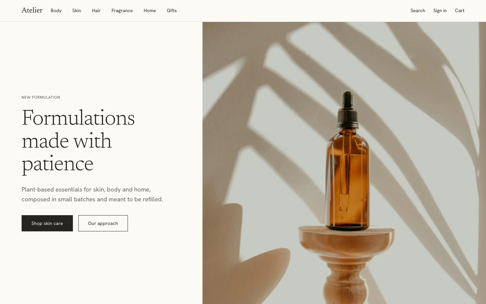
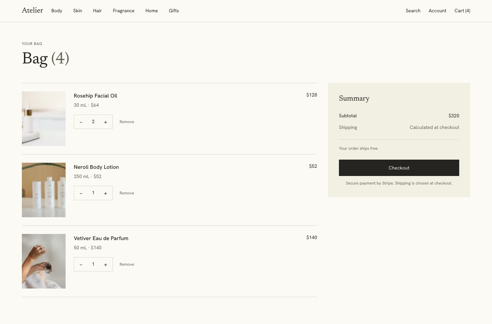
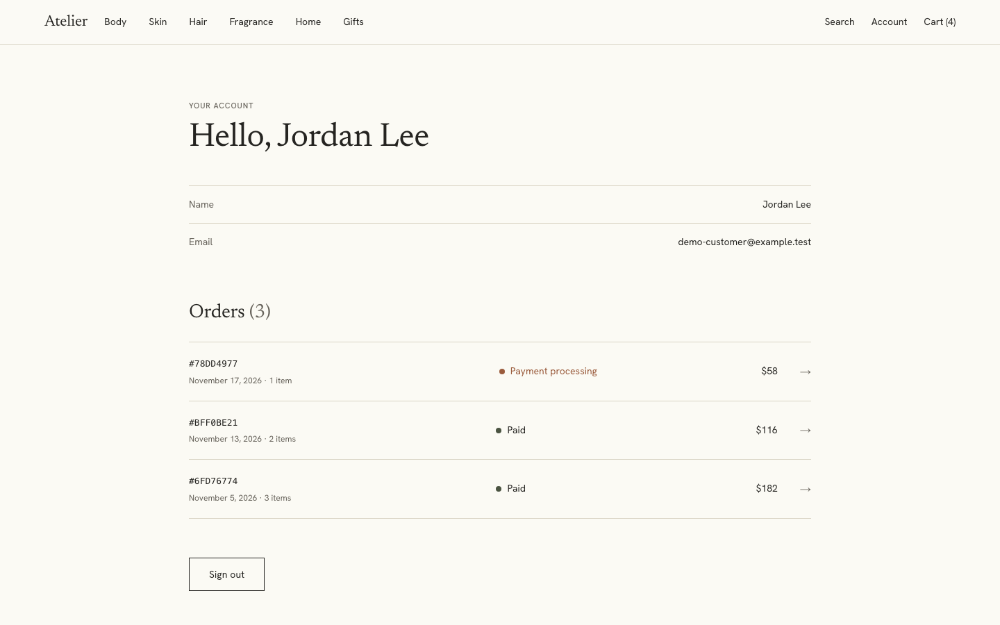
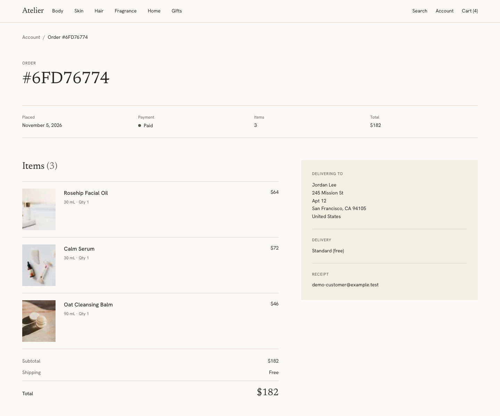
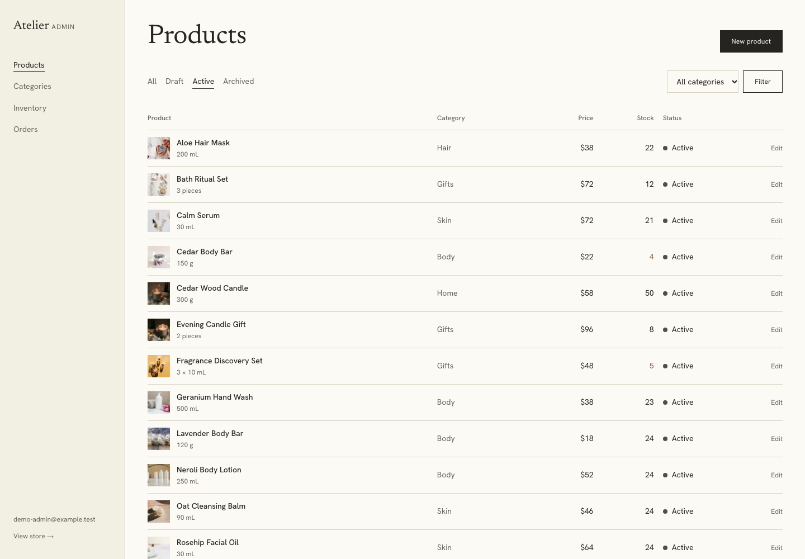
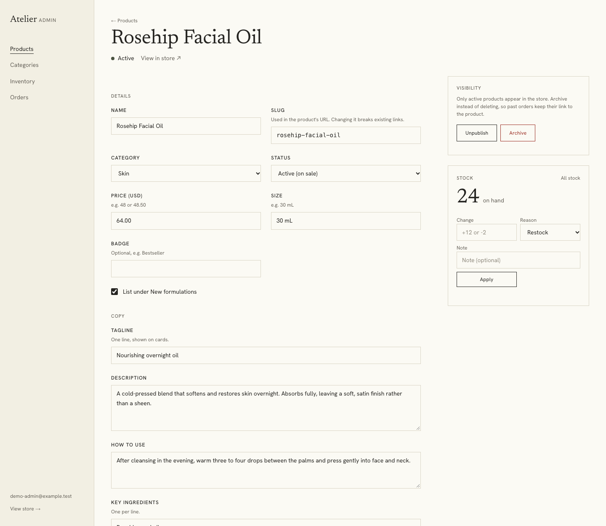
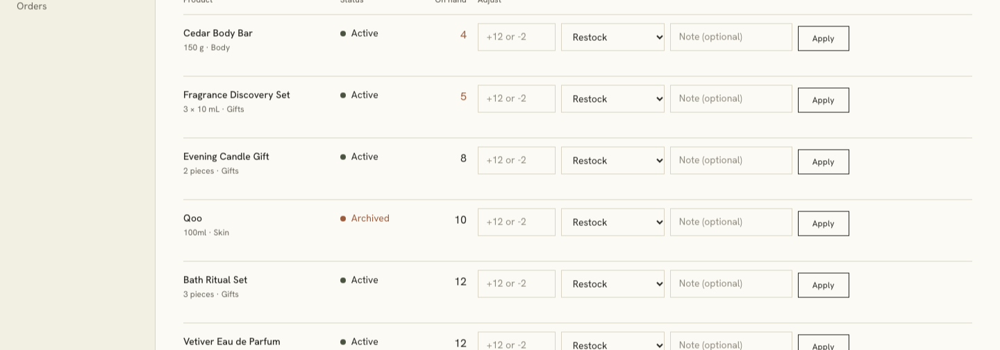
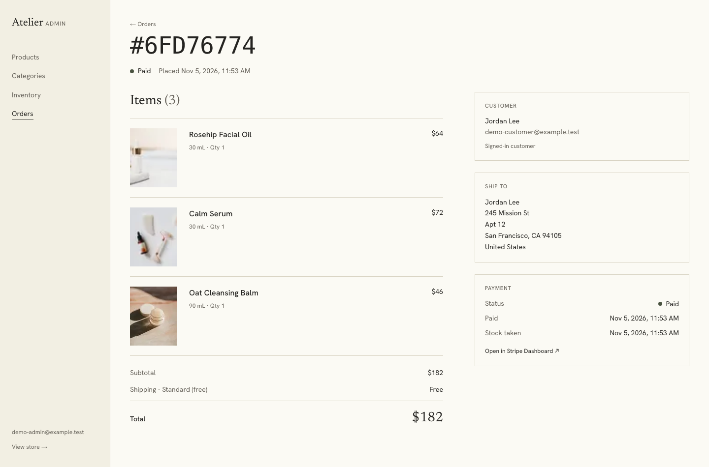

# Atelier

**一個完整的電商網站，品牌設定是手工藥劑風格的保養品牌。包含前台商店、會員帳戶、Stripe 結帳，以及後台管理系統。**

使用 Next.js 16（App Router、Cache Components）、TypeScript、Better Auth、Drizzle ORM 搭配 Neon Postgres、Stripe Checkout，以及 Tailwind CSS v4。

[English](README.md)



## 目錄

- [功能](#功能)
- [技術選型](#技術選型)
- [技術重點](#技術重點)
- [截圖](#截圖)
- [專案結構](#專案結構)
- [本機執行](#本機執行)
- [指令](#指令)
- [現況與後續規劃](#現況與後續規劃)

## 功能

**前台商店**
- 有首頁、分類頁、新品頁和商品頁。商品資料有快取，頁面會預先產生。
- 即時顯示庫存狀態，例如「僅剩 3 件」或「已售完」。已售完或已下架的商品不能加入購物車。
- 支援手機版（含側邊選單），微動畫也會配合「減少動態效果」的系統設定。

**會員帳戶**
- 可以用 email 加密碼註冊，也可以用 Google 登入（選用）。Google 帳號的 email 跟現有帳號相同時，會自動連結到同一個帳號。
- 訪客的購物車存在資料庫裡，用 httpOnly cookie 對應；登入後會自動合併到會員的購物車。
- 有歷史訂單和訂單詳細頁。所有查詢都限定在目前登入的會員，看不到別人的訂單。

**結帳與訂單**
- 使用 Stripe Checkout，會收集寄送地址，提供標準和快遞兩種運費（標準運費滿 $75 免運）。金額一律從資料庫計算，不採用瀏覽器傳來的價格。
- 透過有簽章驗證的 Stripe webhook 建立訂單、扣庫存、清空購物車。同一個事件重送，或事件順序顛倒，結果都一樣正確。
- 付款完成後的確認頁會顯示商品、配送資訊和後續流程。

**後台管理**（`/admin`，僅限管理員）
- 商品：列表、篩選、新增、編輯，以及上架、下架和封存。不提供刪除，改用封存。
- 分類：新增、編輯、排序（前台導覽列會照這個順序），而且只有空的分類可以刪除。
- 庫存：數量少的排在前面。每次調整都是相對增減（進貨、盤點修正、損壞），並寫入異動紀錄，記下操作人和原因。
- 訂單：可依付款狀態篩選和分頁；訂單詳細頁有連結到 Stripe Dashboard。

## 技術選型

| 項目 | 選擇 |
| --- | --- |
| 框架 | Next.js 16 App Router 加上 Cache Components、React 19、TypeScript |
| 樣式 | Tailwind CSS v4，自己建立以 token 為基礎的設計系統，沒有使用 UI 套件 |
| 資料庫 | Neon serverless Postgres，透過 Drizzle ORM（`neon-http`），使用 SQL migration |
| 身分驗證 | Better Auth：email/密碼、Google OAuth、角色欄位 |
| 金流 | Stripe Checkout（Stripe 代管的付款頁）、webhook，本機用 Stripe CLI 轉送事件 |
| 驗證 | Zod：啟動時驗證環境變數，每個 Server Action 也都驗證輸入 |

## 技術重點

程式碼中值得一看的設計：

**1. 不會重複處理的訂單建立** — [`src/db/queries/orders.ts`](src/db/queries/orders.ts)、[`src/app/api/webhooks/stripe/route.ts`](src/app/api/webhooks/stripe/route.ts)
Stripe 可能重複送出同一個事件，也可能不照順序送，所以 webhook 會：
- 用原始的 request body 驗證簽章。
- 重新向 Stripe 取得 Checkout Session，不直接相信事件裡的資料。
- 以 `stripe_checkout_session_id` 這個 unique 欄位建立訂單，同一筆結帳只會有一筆訂單。

扣庫存用的是**單一 SQL statement**：在同一個 statement 裡，先標記 `orders.stock_deducted_at`，再扣庫存。如果同時有重送的請求，它會卡在同一筆訂單的鎖上，等前一個完成後發現已經扣過，就什麼都不做。商品是用 ID 對應的，所以就算結帳途中商品的 slug 被改了，庫存也不會漏扣。

**2. 不會互相覆蓋的庫存調整** — [`src/app/admin/inventory/actions.ts`](src/app/admin/inventory/actions.ts)
後台調整庫存一律是相對增減（`+12`、`-2`），不是直接「設成 N」。同一個 statement 會同時調整數量並寫入異動紀錄，而且只有在目前的庫存還等於管理員看到的數字時才會執行。如果這段期間剛好有訂單付款、庫存已經變了，管理員會看到衝突提示，這次調整不會套用，所以不會蓋掉 webhook 剛扣掉的數量。庫存也不會變成負數。這個 serverless 資料庫驅動不支援互動式 transaction，所以每個需要多個步驟的寫入，都是用單一 statement 或具原子性的 `db.batch` 完成。

**3. 多層權限檢查** — [`src/lib/dal.ts`](src/lib/dal.ts)
- 管理員角色存在 `user.role` 欄位，在 Better Auth 設定成 `input: false`，所以使用者無法透過註冊或更新資料的 API 把自己升級成管理員。
- 權限檢查集中在 server-only 的資料存取層，並在三個地方檢查：每個後台頁面、每個後台 Server Action（在解析任何輸入之前），以及每個後台查詢。
- 不是管理員的人會看到 404，不會知道後台的存在。
- 驗證方式：用一般客戶的 session 直接呼叫每一個 Server Action，全部都被拒絕，資料庫也完全沒有變動。

**4. Next.js 16 Cache Components**
- 商品資料用 `"use cache"` 搭配 `cacheTag("catalog")` 快取，頁面能預先產生成靜態內容。
- 每個訪客都不同的部分（購物車數量、會員帳戶、訂單頁）放在 `<Suspense>` 裡串流輸出。
- 後台的 Server Action 呼叫 `updateTag("catalog")`，webhook 則呼叫 `revalidateTag`，所以後台的修改和新的銷售都會立刻反映到前台。

**5. 長期維持正確的資料**
- 訂單明細會記下購買當時的商品名稱、容量和價格（快照）。
- 商品用封存取代刪除。封存的商品會從前台消失；如果已經在顧客的購物車裡，會被標示出來，而且會擋下結帳。
- 資料庫變更都先產生 SQL migration（`drizzle/`），檢查後才套用，從不直接用 `db push`。

## 截圖

| 前台 | |
| --- | --- |
|  |  |
| 商品頁 | 購物車：即時計算金額與免運門檻 |
|  |  |
| 會員帳戶與歷史訂單 | 訂單詳細頁 |

| 後台 | |
| --- | --- |
|  |  |
| 商品列表：庫存與狀態 | 商品編輯：上架狀態與庫存調整 |
|  |  |
| 庫存：數量少的排前面，可直接調整 | 訂單詳細頁 |

<p align="center"></p>

## 專案結構

```
src/
  app/
    (store)/            前台 route group：首頁、分類、商品、購物車、結帳、會員、登入
    admin/              後台：商品、分類、庫存、訂單（有自己的 layout）
    api/auth/           Better Auth 的路由
    api/webhooks/stripe Stripe webhook：先驗證簽章，再建立訂單
  components/           共用 UI 元件，以及前台、購物車、訂單、後台的元件
  db/
    schema/             Drizzle 資料表定義：商品、會員、購物車、訂單、庫存異動紀錄
    queries/            資料存取：有快取的商品查詢、購物車、訂單、後台查詢
    seed/               初始商品資料（pnpm db:seed）
  lib/
    env.ts              用 Zod 驗證的環境變數，啟動時讀取一次
    auth.ts, dal.ts     Better Auth 設定，以及頁面、action 和查詢共用的權限檢查
    stripe.ts           Stripe client
drizzle/                檢查過的 SQL migration
```

**資料模型：** `categories`、`products`（含 `status`）、`inventory`（與商品一對一）、`inventory_adjustments`（異動紀錄）、`carts` 和 `cart_items`、`orders` 和 `order_items`（含價格快照），以及 Better Auth 的 `user`、`session`、`account`、`verification`。

## 本機執行

**需要先準備：** Node.js 20 以上、pnpm、一個 [Neon](https://neon.tech) Postgres 資料庫、一個 [Stripe](https://stripe.com) 沙盒帳號，以及 [Stripe CLI](https://docs.stripe.com/stripe-cli)。

```bash
pnpm install
cp .env.example .env.local      # 填入下表的值
pnpm db:migrate                 # 建立資料表
pnpm db:seed                    # 載入範例商品（會重設庫存）
pnpm dev
```

| 環境變數 | 用途 |
| --- | --- |
| `DATABASE_URL` | Neon 的連線字串 |
| `BETTER_AUTH_SECRET` | 簽署 session 用的密鑰（`openssl rand -base64 32`） |
| `BETTER_AUTH_URL`、`NEXT_PUBLIC_APP_URL` | 網站網址，例如 `http://localhost:3000` |
| `STRIPE_SECRET_KEY` | Stripe 測試模式金鑰（`sk_test_…`，或權限受限的 `rk_test_…`） |
| `STRIPE_WEBHOOK_SECRET` | 執行 `stripe listen` 時印出的 `whsec_…`（見下方） |
| `GOOGLE_CLIENT_ID`、`GOOGLE_CLIENT_SECRET` | 選用；兩個都有設定時，才會顯示 Google 登入按鈕 |

**在本機接收 Stripe webhook**（另開一個終端機）：

```bash
stripe listen \
  --events checkout.session.completed,checkout.session.async_payment_succeeded,checkout.session.async_payment_failed \
  --forward-to localhost:3000/api/webhooks/stripe
```

付款時用測試卡號 `4242 4242 4242 4242`，有效期限填任何未來的日期，CVC 填任意數字。

**把自己設成管理員。** 這個網站刻意不提供讓使用者自己升級成管理員的功能。先註冊帳號，再執行：

```sql
UPDATE "user" SET role = 'admin' WHERE email = 'you@example.com';
```

## 指令

| 指令 | 用途 |
| --- | --- |
| `pnpm dev` / `pnpm build` / `pnpm start` | 開發模式、建置、啟動正式版 |
| `pnpm lint` / `pnpm typecheck` | ESLint，以及 `next typegen && tsc --noEmit` |
| `pnpm db:generate` / `pnpm db:migrate` | 依照 schema 產生 SQL migration，再套用到資料庫 |
| `pnpm db:seed` | 寫入範例商品（會覆蓋庫存和商品的修改） |
| `pnpm db:studio` | 瀏覽資料庫 |

## 現況與後續規劃

這是作品集專案，金流接的是 Stripe 沙盒，只有測試模式，不會真的收款。

**驗證方式：** 目前還沒有自動化測試。每次修改都會：
- 跑 `pnpm typecheck`、`pnpm lint` 和 `pnpm build`。
- 用腳本發送 HTTP 請求、直接呼叫 Server Action，並分別用每種身分測試權限。
- 檢查資料庫裡的資料是否正確。
- 截圖確認桌機版和手機版的畫面。

**接下來會做的**
- 訂單通知信：訂單確認、出貨、退款。
- 出貨狀態與物流追蹤碼。
- 透過 Stripe API 退款，再由 webhook 同步狀態。
- 自動化測試：價格與庫存規則的單元測試，以及結帳和後台權限的端對端測試。
- 讓後台可以直接上傳圖片，取代貼圖片網址。
- email 驗證。
